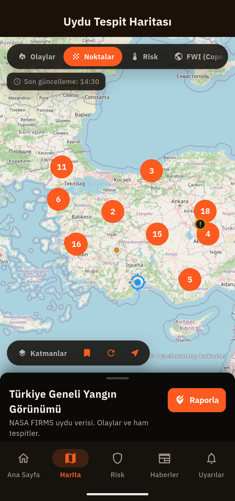
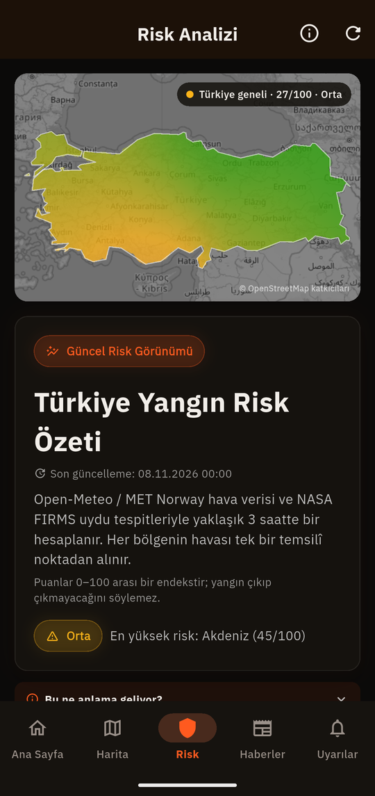
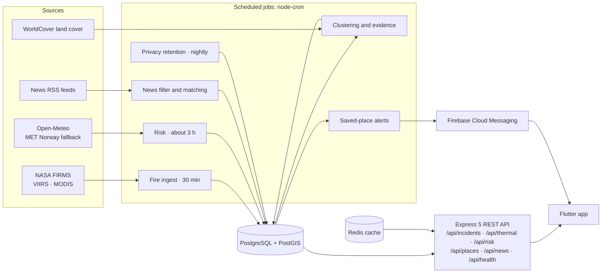

# FireWatch TR Backend

**The API behind the FireWatch TR app: it turns raw NASA satellite detections into wildfire incidents across Türkiye, scores fire risk and sends location-based alerts.**

[](https://play.google.com/store/apps/details?id=com.oguzh.firewatch.firewatch_tr)


**[Google Play](https://play.google.com/store/apps/details?id=com.oguzh.firewatch.firewatch_tr)** · [Flutter app repository](https://github.com/OrhanIzmirli/firewatch-tr) · [Privacy policy](https://firewatch-tr-backend.onrender.com/privacy)

Built as a small team project; this README focuses on the parts I built.

| Detections served to the app | Risk scores served to the app |
|---|---|
|  |  |

Screenshots are from the app, version 1.2.0, with the Turkish interface. Saved-place map pins are masked.

> FireWatch TR is not an emergency service and does not forward reports to any authority. Satellite data shows heat, not confirmed fires.

## Highlights

- **Satellite ingestion.** NASA FIRMS VIIRS and MODIS detections every 30 minutes, kept inside a Türkiye border gate built in PostGIS.
- **Incident clustering.** DBSCAN on an equal-area projection, with spread direction, power trend and a land-cover check.
- **Province assignment.** One SQL function, `province_for_point()`, backed by the 81 real province polygons.
- **Transparent risk score.** One 0 to 100 function for regions, single points and saved-place alerts, with an Open-Meteo to MET Norway fallback.
- **Saved-place alerts.** Radius matching on the server, delivered through Firebase Cloud Messaging.
- **Retention in code.** Locations rounded to about 1 km, a nightly 90-day cleanup and a delete endpoint.
- **Own monitoring.** Every job records its runs, and `/api/health` reports whether the pipeline is alive.

## Architecture



## Engineering decisions

**Honest labels start in the API.** Alert text calls a satellite count heat detections and says it is not a confirmed fire. An incident counts as a past fire only if it was seen on at least two overpasses or reached 8 MW. Without that bar, the home screen said 194 fires had ended next to a map showing 15, and most of those were single-pass hot pixels. When data is stale the API returns unknown, never zero.

**Small is not noise.** DBSCAN runs with `minPoints = 1` on purpose, because a lone hot pixel is what a fire looks like on its first overpass. The 1,200 m radius is measured in EPSG:3035, since the same distance in degrees varies by about 30% across Türkiye.

**Privacy enforced at every write path.** The exact position is used to resolve the province, then only a value rounded to two decimals (about 1 km) is stored. Coordinates are removed from request logs. Every night, one transaction deletes devices and reports past 90 days and devices whose push token has been dead for 7 days. A static test reads the source and fails if a write path skips these rules.

**Province assignment from real polygons.** Originally every lookup used the nearest province centre, and a check on 7 November 2026 showed that a quarter of incidents had the wrong province. Migration 015 added the 81 province polygons and one function for every caller. The migration is generated from a GeoJSON file pinned by SHA-256 and shared with the app. Existing rows were corrected by a separate backfill that logs each old value, so it can be undone.

**A border gate tuned on measured data.** A flat 5 km buffer pulled in detections from neighbouring countries. The gate is now 1.5 km on land borders and 5 km along the coast. On the live data, that moved 1,579 detections outside the gate and kept 155 coastal ones.

**An accuracy audit against raw data.** 98 of 98 detections matched the raw NASA file, and 7 of 7 regions matched on weather and on hand-recalculated risk scores. The audit also found that report matching was reading an empty table, so no report could ever match. It now reads real detections within 10 km and 24 hours. Full report in the [app repository](https://github.com/OrhanIzmirli/firewatch-tr).

## Tech stack

| Area | Tools |
|---|---|
| API | Node.js 22, TypeScript, Express 5 |
| Data | PostgreSQL with PostGIS, Redis (`ioredis`) |
| Jobs | `node-cron` |
| Notifications | Firebase Admin, Cloud Messaging |
| Deployment | Docker, Render |

## Tests

350+ checks run without a database, one `npm run test:<name>` script per area, covering location privacy, border gate, risk, alert text, heat sources, news relevance and saved places. Separate `*-db` suites and the news verification script need a real PostgreSQL database.

## Run it locally

Needs Node.js 22, PostgreSQL with PostGIS, and Redis.

```bash
cp .env.example .env   # fill in DATABASE_URL, REDIS_URL and NASA_API_KEY
npm ci
npm run build
npm start
```

Apply `database/schema.sql` and then the files in `database/migrations` in order.

## Data and attribution

Fire data from NASA FIRMS. Weather from Open-Meteo and MET Norway. Province boundaries from geoBoundaries, derived from OpenStreetMap, © OpenStreetMap contributors (ODbL 1.0).

## Author

Orhan Izmirli, Computer Science student in Warsaw.
